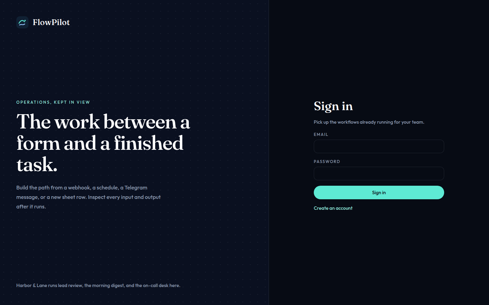
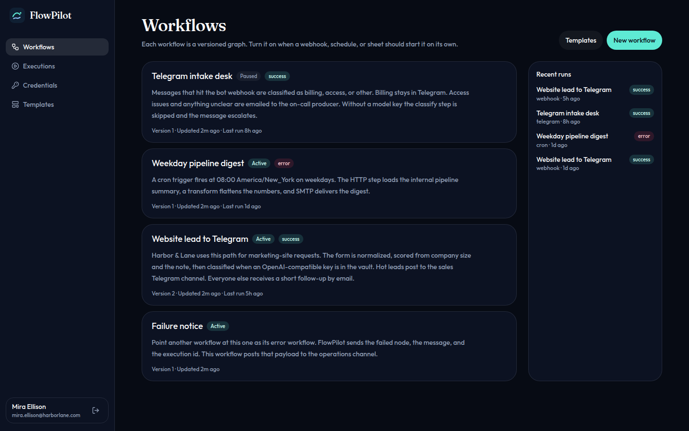
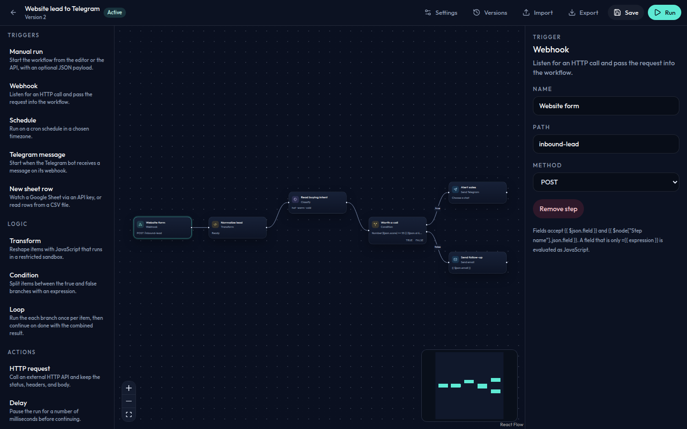
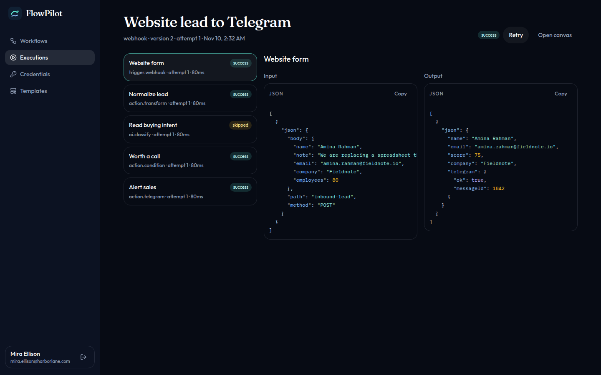
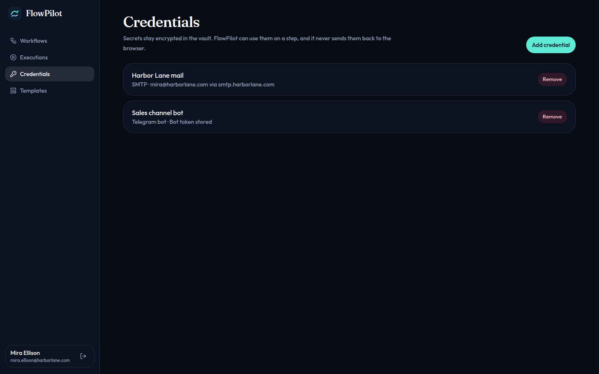
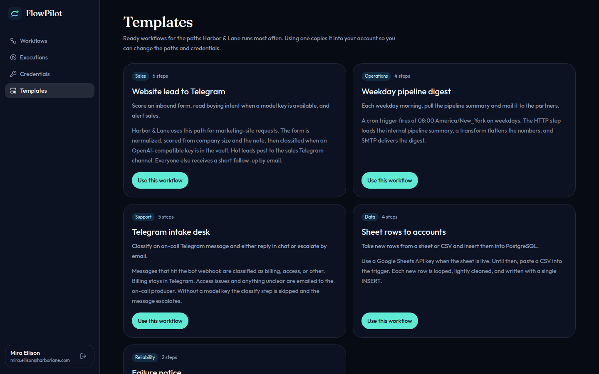
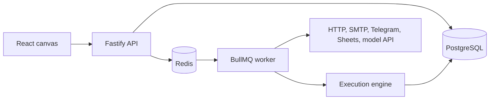

# FlowPilot

FlowPilot is a visual workflow builder for operational teams. You draw a graph of triggers, checks, and side effects, turn it on, and keep a record of every input and output.

A webhook, a weekday schedule, a Telegram message, or a new spreadsheet row can start a run. From there the graph can call HTTP APIs, reshape data with sandboxed JavaScript, branch, loop, wait, send Telegram or email, write a row to PostgreSQL, or ask an OpenAI-compatible model to classify and extract. Model steps stay quiet when no key is saved, and the rest of the graph continues.

## Features

- Canvas for triggers, actions, logic, and model steps, with a configuration panel on each node
- Triggers: webhook, cron schedule, manual run, Telegram message, and new rows from Google Sheets or a CSV file
- Actions: HTTP request, JavaScript transform, condition, loop, delay, Telegram message, SMTP email, and a single INSERT or UPDATE against PostgreSQL
- Model steps: prompt, classify, and JSON extraction through any OpenAI-compatible chat API
- Execution history with the input and output of every step, plus retry and cancel for a queued run
- Error workflows that receive the failed step, the message, and the execution id
- Credential vault encrypted at rest with AES-256-GCM. Secrets are write-only after they are saved
- Immutable workflow versions, with restore
- Import and export as JSON
- Ready workflows for inbound lead review, a weekday pipeline digest, Telegram intake, sheet rows into PostgreSQL, and a failure notice

Step JavaScript runs in a restricted V8 context. Dynamic code generation is disabled, the step has a time limit, and host bindings such as `process` are not available. People who can edit a workflow should be treated as operators of that instance. SQL steps accept one INSERT or UPDATE. HTTP steps refuse link-local metadata addresses.

## Interface

Sign in, then the workflow list, the canvas, a run, the vault, and the template gallery.













## Architecture



The API stores workflows, versions, credentials, and execution records. A run is a job on the `flowpilot-executions` queue. The worker loads that version, decrypts only the credentials the steps ask for, and walks the graph. Schedules and sheet polls are checked from the worker. `EXECUTION_MODE=inline` runs the same engine inside the API process, which is what the automated suite uses.

## Tech stack

- TypeScript across the workspace
- React, Vite, React Flow, Tailwind CSS
- Fastify, BullMQ, ioredis
- PostgreSQL, Prisma
- Node `vm` sandbox with dynamic code generation disabled
- Vitest for the engine, the vault crypto, and the HTTP API
- GitHub Actions, Docker, Docker Compose

## Quick start

Generate two 32-byte secrets and a database password before the first boot:

```bash
openssl rand -hex 32
```

Use one value for `JWT_SECRET` and another for `ENCRYPTION_KEY`.

### Docker Compose

```bash
cp .env.example .env
```

Fill `POSTGRES_PASSWORD`, `JWT_SECRET`, `ENCRYPTION_KEY`, and `SEED_USER_PASSWORD`. Compose builds `DATABASE_URL` for the containers. Set `WEB_ORIGIN=http://localhost:8080` if you open the bundled UI.

```bash
docker compose up --build -d
docker compose --profile seed run --rm seed
```

Open [http://localhost:8080](http://localhost:8080). The API is also on port 4000. Seed data for local development creates Mira Ellison (`SEED_USER_EMAIL`, default `mira.ellison@harborlane.com`) and the Harbor & Lane workflows. Vault entries created by the seed use generated values, not live tokens.

### Local processes

You need PostgreSQL 16, Redis, and Node.js 22.

```bash
cp .env.example .env
pnpm install
pnpm --filter @flowpilot/db exec prisma migrate deploy
pnpm db:seed
pnpm dev
pnpm dev:worker
```

`pnpm dev` starts the API on port 4000 and the Vite app on port 5173. Load the variables from `.env` into the shell before those commands. Use `EXECUTION_MODE=inline` when you do not want a separate worker, or `queue` together with `pnpm dev:worker`.

## Environment

| Variable             | Purpose                                                                                      |
| -------------------- | -------------------------------------------------------------------------------------------- |
| `DATABASE_URL`       | PostgreSQL connection string for the API and migrations                                      |
| `REDIS_URL`          | Redis connection string for the execution queue                                              |
| `JWT_SECRET`         | HMAC secret for session tokens. At least 32 characters. Generate with `openssl rand -hex 32` |
| `ENCRYPTION_KEY`     | 64 hex characters (32 bytes) for AES-256-GCM. Generate with `openssl rand -hex 32`           |
| `POSTGRES_PASSWORD`  | Database password required by Docker Compose. No default is set                              |
| `SEED_USER_PASSWORD` | Password for the local development account created by the seed                               |
| `SEED_USER_EMAIL`    | Optional. Defaults to `mira.ellison@harborlane.com`                                          |
| `SEED_USER_NAME`     | Optional. Defaults to `Mira Ellison`                                                         |
| `WEB_ORIGIN`         | Browser origin allowed by CORS                                                               |
| `EXECUTION_MODE`     | `queue` or `inline`                                                                          |
| `ALLOW_SIGNUP`       | `true` or `false`. Turn this off on a shared instance                                        |
| `PORT`               | API port. Default 4000                                                                       |
| `LOG_LEVEL`          | Pino log level                                                                               |

Model keys, bot tokens, SMTP passwords, and database URLs used by steps belong in the vault, not in the process environment.

## Project structure

```
apps/api        Fastify API, worker, and seed
apps/web        React canvas
packages/engine Graph runner and node handlers
packages/shared Step catalog, templates, and graph validation
packages/db     Prisma schema, migrations, and vault crypto
```

## Scripts

```bash
pnpm lint
pnpm format:check
pnpm build
pnpm typecheck
pnpm test
```

GitHub Actions runs the same checks against PostgreSQL and Redis.

## Roadmap

- Shared editing on one canvas
- Slack and more inboxes beside Telegram
- A step debugger that pauses on a chosen node
- Roles inside a workspace
- Folders and tags for large graphs

## По-русски

FlowPilot — визуальный конструктор рабочих процессов. На холсте собираются триггеры (webhook, расписание, ручной запуск, сообщение Telegram, новая строка Google Sheets или CSV), действия (HTTP, JavaScript в ограниченной среде, условие, цикл, пауза, Telegram, письмо по SMTP, запись в PostgreSQL) и шаги с моделью (промпт, классификация, извлечение JSON). Если ключа к API нет, шаг модели пропускается, а остальной процесс продолжается.

У каждого запуска сохраняются вход и выход шагов. Есть повтор, сценарий на ошибку, зашифрованное хранилище секретов, версии графа, импорт и экспорт JSON и готовые процессы: заявка с сайта в Telegram, утренний дайджест, разбор сообщений, перенос строк в PostgreSQL.

Быстрый старт: заполните `.env` (секреты — `openssl rand -hex 32`), затем `docker compose up --build -d` и `docker compose --profile seed run --rm seed`. Интерфейс открывается на http://localhost:8080.

## License

MIT. See [LICENSE](LICENSE).
